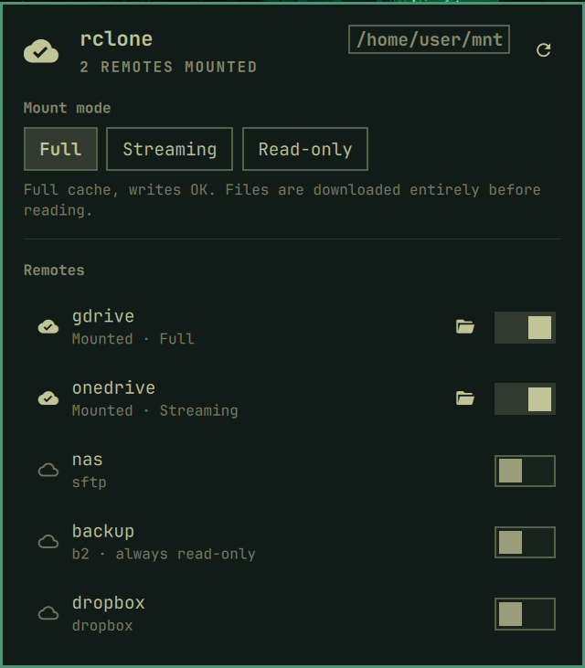
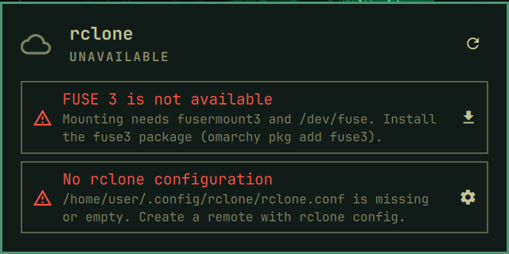

# rclone mounter

An [Omarchy](https://omarchy.org) bar widget that lists your
[rclone](https://rclone.org) remotes and mounts or unmounts them in one click.



- One switch per remote; mounts go to `~/mnt/<remote>` (configurable).
- Three VFS cache modes, picked in the panel before mounting:
  - **Full**: `--vfs-cache-mode full` (5 GB / 24 h cache). Files are fully
    downloaded before reading, writes are safe.
  - **Streaming**: `--vfs-cache-mode writes` with chunked reads. Best for media.
  - **Read-only**: `--read-only`. The remote cannot be modified.
- Remotes can be hidden, or forced read-only (useful for a backup repository).
- Encrypted rclone configs are unlocked with a password kept in the keyring.
- Checks its prerequisites and shows an alert with a fix-it button when
  something is missing: rclone, FUSE 3, an rclone config or a remote, and
  (for encrypted configs) `secret-tool` and `zenity`.

  

- Follows the Omarchy theme. English by default, French when the Omarchy
  language is French, or (with no Omarchy language set) when the system
  locale is (`LC_ALL`, `LC_MESSAGES`, then `LANG`). See [Language](#language).

## Install

```bash
omarchy plugin add https://github.com/snouhaud/rclone-mounter.git --enable
```

Omarchy asks where to put the widget in the bar (default: right).
Move it later with `omarchy bar move io.github.snouhaud.rclone-mounter --section <section>`.

### Requirements

| Package    | Why                                                      |
|------------|----------------------------------------------------------|
| `rclone`   | lists and mounts remotes                                 |
| `fuse3`    | `fusermount3` and `/dev/fuse`, needed to mount           |
| `jq`       | used by the helper script (shipped with Omarchy)         |
| `libsecret`, `zenity` | only for an encrypted rclone config           |
| `libnotify` | optional, desktop notifications on mount/unmount        |

Create remotes with `rclone config` if you have none yet.

## Uninstall

1. Unmount your remotes first (switch them off in the panel). Mounts are
   independent `rclone mount --daemon` processes and stay mounted after the
   plugin is removed; to unmount one by hand: `fusermount3 -uz ~/mnt/<remote>`.
2. Remove the plugin. This disables it, takes it out of the bar and deletes
   its folder:

   ```bash
   omarchy plugin remove io.github.snouhaud.rclone-mounter
   ```

3. Optional cleanup. The plugin never edits your rclone configuration. It
   leaves behind only the mode files `~/mnt/.<remote>.mode`, empty mount
   folders, and the keyring password if you stored one:

   ```bash
   rm -f ~/mnt/.*.mode
   secret-tool clear service rclone key config   # only if nothing else uses it
   ```

## Use

- **Bar icon**: dim cloud when nothing is mounted; cloud with a check mark and
  the number of mounts otherwise; red `!` when a prerequisite is missing.
  Left click opens the panel, right click refreshes.
- **Panel keys**: `↑`/`↓` move, `←`/`→` change mode, `Enter` mount/unmount,
  `m` cycle mode, `o` open the mounted folder, `r` refresh, `u` unlock,
  `f` forget the keyring password, `c` run `rclone config`.

### Encrypted rclone config

The password is read from the Secret Service keyring (GNOME Keyring, KeePassXC…)
under the attributes `service rclone key config`. If it is not there, the panel
shows an **Unlock** row that asks for it with zenity, checks it, and stores it.
To store it yourself:

```bash
secret-tool store --label="rclone config" service rclone key config
```

To remove it, use **Forget the keyring password** at the bottom of the panel
(click twice to confirm, or press `f` twice). Mounts already running keep
working; the next unlock asks for the password again. If the stored password
stops working (for example after `rclone config` changed it), the panel shows
an alert and lets you enter it again or forget it. From a terminal:

```bash
secret-tool clear service rclone key config
```

## Language

The panel, notifications and password dialog pick their language
in this order:

1. the language chosen in Omarchy (Setup > Language, stored in
   `~/.config/omarchy/language`);
2. otherwise the system locale: `LC_ALL`, then `LC_MESSAGES`, then `LANG`;
3. English.

A language without a catalog in `i18n/` shows English, string by string.
To add one, copy `i18n/en.json` to `i18n/<code>.json` (for example `de.json`)
and translate the values; plural entries take the CLDR categories `one`/`other`.

## Settings

Change them in the Omarchy settings panel, or with
`omarchy bar set io.github.snouhaud.rclone-mounter <key> <value>`:

| Key                  | Default | Meaning                                         |
|----------------------|---------|-------------------------------------------------|
| `mountBase`          | `~/mnt` | folder that holds the mount points              |
| `defaultMode`        | `full`  | `full`, `writes` or `read-only`                 |
| `excludedRemotes`    | empty   | comma-separated remotes to hide                 |
| `readOnlyRemotes`    | empty   | comma-separated remotes always mounted read-only|
| `openAfterMount`     | `true`  | open the folder after mounting                  |
| `showCount`          | `true`  | show the number of mounts next to the icon      |
| `refreshIntervalSec` | `30`    | how often the state is refreshed                |

The mode used for each mount is remembered in `<mountBase>/.<remote>.mode`.

## IPC

```bash
omarchy-shell io.github.snouhaud.rclone-mounter status          # one line per remote
omarchy-shell io.github.snouhaud.rclone-mounter mount gdrive writes
omarchy-shell io.github.snouhaud.rclone-mounter unmount gdrive
omarchy-shell io.github.snouhaud.rclone-mounter forget          # delete the keyring password
omarchy-shell io.github.snouhaud.rclone-mounter refresh | toggle | open | close
```

## How it works and safety

`Panel.qml` (UI) and `Service.qml` (state) call `rclone-mounts.sh`, which prints
one JSON line per command. Arguments are passed as argv, never through a shell
string. Remote names, modes and the mount folder are validated before use, and
all text is rendered as plain text. The plugin makes no network request of its
own; only rclone talks to your remotes. The only commands it launches in a
terminal are fixed ones (`omarchy pkg add <package>`, `rclone config`).

Run the tests (no network, no real mount; rclone is faked):

```bash
tests/run.sh
```

## License

MIT, see [LICENSE](LICENSE).
